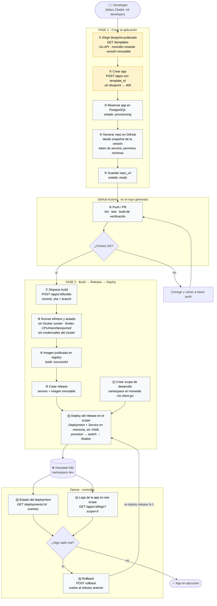

# DEV-FORGE — Plan de Implementación y Seguimiento

> Tracking de tareas, estado de fases y criterios de verificación.
> Actualizar este archivo cada vez que se complete una tarea.
>
> **Diseño y arquitectura:** [docs/DESIGN.md](docs/DESIGN.md)
> **Schema de base de datos:** [docs/db-schema.md](docs/db-schema.md)

**Última actualización:** 2026-10-09
**Estado global:** 🔵 En progreso — Fase 1: auth ✅ + Swagger ✅; catálogo de blueprints y creación de aplicaciones en actualización (1.4–1.10)

---

## Leyenda de Estado

| Símbolo | Estado |
|---|---|
| ⬜ | No iniciado |
| 🔵 | En progreso |
| ✅ | Completado |
| ⏸️ | Pausado / Bloqueado |
| ⏭️ | Skipped (decisión explícita) |

---

## Resumen por Fase

| Fase | Nombre | Estado | Progreso |
|---|---|---|---|
| 0 | Setup del Proyecto | ✅ | 9/10 activas (1 skipped) |
| 1 | Auth (Zitadel) + Applications + Blueprints + Git | 🔵 | 4/13 ✅ + 1.4–1.7, 1.10 🔵 |
| 2 | Build → Release → Deploy Pipeline | ⬜ | 0/11 |
| 3 | Configuration + Services | ⬜ | 0/6 |
| 4 | Observabilidad (OTEL + Grafana Stack) | ⬜ | 0/9 |
| 5 | Governance + Audit + Notifications | ⬜ | 0/8 |
| 6 | Self-Deploy + Portfolio Ready | ⬜ | 0/9 |

---

## Fase 0: Setup del Proyecto 🔵

> Fundamentos del proyecto: estructura, infraestructura local, tooling.

| # | Tarea | Estado | Fecha inicio | Fecha fin | Notas |
|---|---|---|---|---|---|
| 0.1 | Crear `dev-forge.code-workspace` | ⏭️ | — | — | Skipped: se trabaja directamente en `dev_forge/` |
| 0.2 | Inicializar repo Go con go modules | ✅ | 2026-04-28 | 2026-04-28 | `go mod init github.com/cristianortiz/dev-forge` |
| 0.3 | Crear estructura de carpetas (cmd, internal, migrations, deployments) | ✅ | 2026-04-28 | 2026-04-28 | Todos los módulos creados |
| 0.4 | Docker Compose: PostgreSQL local | ✅ | 2026-04-28 | 2026-04-28 | El Compose actual levanta PostgreSQL; Zitadel usa Cloud. Redis no forma parte del entorno hasta justificar un caso de uso. |
| 0.5 | Package `shared/config` | ✅ | 2026-04-28 | 2026-04-28 | Struct tipada, helpers `getEnv*`, `Load()`, `LogLevel()` |
| 0.6 | Package `shared/database` | ✅ | 2026-04-28 | 2026-04-28 | pgxpool + otelpgx opcional |
| 0.7 | Package `shared/logger` | ✅ | 2026-04-28 | 2026-04-28 | Zap, JSON en prod / console en dev |
| 0.8 | Package `shared/server` | ✅ | 2026-04-28 | 2026-04-28 | Fiber v2, CORS, recovery, zapLogger, `/health`, `/ready` |
| 0.9 | Makefile | ✅ | 2026-04-28 | 2026-04-28 | Targets: build, test, lint, migrate-*, dev, docker-* |
| 0.10 | Verificar conectividad homelab K8s (kubeconfig, client-go ping) | ⬜ | — | — | Requiere kubeconfig local configurado |
| 0.11 | Configurar Zitadel: proyecto `dev-forge`, roles, app OIDC | ✅ | 2026-05-11 | 2026-05-21 | Zitadel Cloud; app JWT Profile; service user dev-forge-test con PAT |

**Notas de implementación verificadas:**
- `go.mod`: Go 1.26, Fiber v2, pgx v5, Zap, OTEL, otelpgx ✅
- `.env.example`: variables App, DB, Zitadel, OTEL documentadas ✅
- Zitadel Cloud configurado: proyecto `dev-forge`, roles admin/developer/viewer, app JWT Profile ✅
- `secrets/zitadel-api-key.json`: key RSA de la API app (gitignored) ✅
- `docs/zitadel-setup.md`: guía completa de setup y arquitectura de auth ✅
- `internal/shared/telemetry/`: vacío — pendiente Fase 4 (tarea 4.2)
- `internal/shared/middleware/`: auth y validación implementadas; ampliar solo con un caso de uso definido
- `internal/shared/crypto/`: vacío — pendiente Fase 3 (tarea 3.1)
- `migrations/`: existen `000001_create_users` y `000002_create_project_templates`; ambas reflejan parcialmente el modelo anterior y requieren evolución

**Criterios de verificación:**
- [x] `make docker-up` levanta PostgreSQL
- [x] `make dev` arranca el servidor y responde en `/health`
- [x] `make test` ejecuta tests
- [x] `make migrate-up` aplica migración users
- [ ] `kubectl get nodes` conecta al homelab cluster (pendiente 0.10)
- [x] Zitadel Cloud configurado: proyecto, roles, app JWT Profile ✅
- [x] VS Code workspace abierto correctamente

**Próximo paso:** `make docker-up` → verificar conexión con Zitadel Cloud → verificar kubeconfig (0.10).

---

## Recorrido MVP — El camino que hay que cerrar

> **Objetivo:** que un developer pase de "quiero una API nueva" a "mi API corre en Kubernetes y puedo ver su estado y volver atrás" usando solo dev-forge. La prioridad es cerrar este único camino de punta a punta; no replicar todas las capacidades de Nully.

### Diagrama del flujo

> **Colores:** 🟨 en progreso (catálogo y creación de apps, Fase 1) · ⬜ sin iniciar. Auth (Zitadel) ya está completa y protege todos los pasos.

### Paso a paso

| # | Paso | Quién actúa | Módulo / fase | Resultado verificable |
|---|---|---|---|---|
| ① | Listar blueprints publicados | Developer → API | `template` · F1 (1.4–1.6) | Aparece el blueprint Go API con su versión inmutable |
| ② | Crear app indicando `template_id` | Developer → API | `app` · F1 (1.7) | `201`; sin `template_id` → `400` |
| ③ | Reservar la app en DB | API | `app` · F1 (1.8, 1.10) | Fila en estado `provisioning`, clave de idempotencia guardada |
| ④ | Generar repo desde snapshot | API → GitHub | `git` · F1 (1.9) | Repo nuevo con el código del blueprint en esa versión |
| ⑤ | Registrar `repo_url` | API | `app` · F1 (1.8) | App en `ready`; si falló entre ③ y ④, un reintento/reconciliación lo repara sin duplicar repos |
| ⑥ | Validar cambios | GitHub Actions | Blueprint (DESIGN §10) | Lint, tests y build de verificación en verde |
| ⑦ | Disparar build | Developer → API | `build` · F2 (2.1–2.3) | Build `pending` con commit y branch |
| ⑧ | Construir imagen aislada | Runner efímero | `build` · F2 (2.2, 2.11) | Un build que excede límites se detiene y no toca credenciales del cluster |
| ⑨ | Publicar imagen | Runner → registry | `build` · F2 | Build `successful` con referencia de imagen |
| ⑩ | Crear release | Developer → API | `release` · F2 (2.4) | Versión semver ligada a esa imagen |
| ⑪ | Crear scope de desarrollo | Developer → API | `scope` · F2 (2.5–2.6) | Namespace creado en el homelab |
| ⑫ | Desplegar release | API → K8s | `deploy` · F2 (2.7–2.9) | Pod `running`; eventos `provision → switch → finalize` |
| ⑬ | Consultar estado | Developer → API | `deploy` · F2 | Estado y eventos del deployment |
| ⑭ | Consultar logs | Developer → API | `observe/logs` · F4 (4.7) | Logs autorizados solo para esa app/scope |
| ⑮ | Rollback | Developer → API | `deploy` · F2 (2.7) | El pod vuelve al release anterior |

> **Nota de secuencia:** el paso ⑭ depende de Loki (Fase 4). Hasta entonces, el MVP puede validarse con el estado del deployment (⑬); los logs en vivo se añaden al llegar a Fase 4.

### Qué pasa cuando algo falla

| Dónde | Fallo | Comportamiento esperado |
|---|---|---|
| ②–⑤ | GitHub caído o error entre DB y GitHub | La app queda en `provisioning`; el reintento es idempotente y no crea un segundo repo |
| ⑥ | Checks en rojo | No se dispara build; se corrige y se hace push de nuevo |
| ⑧ | Build excede tiempo, memoria o red | Se corta; build `failed`; no hay release ni deploy |
| ⑫ | El pod no arranca | Deployment `failed`; el release anterior sigue sirviendo (si existe) |
| ⑮ | Rollback | Se re-despliega el release N-1; no se reconstruye nada |

### Lo que queda fuera del MVP

Para no dispersar esfuerzo, estos puntos **no** bloquean el recorrido y se atienden en fases posteriores:

- **Un solo blueprint** (Go API, monolito modular) y **un solo cluster** (homelab). Sin otros runtimes.
- **Sin builds dentro del proceso API**: el API solo orquesta al runner.
- **Sin provisioning genérico de bases de datos**. Si la app necesita PostgreSQL/secretos en el primer deploy, depende de la decisión registrada en `docs/DESIGN.md` §12.
- **Sin approvals, audit ni notificaciones** (Fase 5) ni parámetros/servicios (Fase 3) en el camino crítico.
- **Sin frontend**: todo se recorre por la API (Swagger UI en `/api/v1/docs`).

## Fase 1: Auth (Zitadel) + Applications + Blueprints + Git ⬜

> Primer corte vertical: autenticación, CRUD de apps desde plantilla, integración GitHub.

| # | Tarea | Estado | Fecha inicio | Fecha fin | Notas |
|---|---|---|---|---|---|
| 1.1 | Módulo `auth`: domain (User entity, zitadel_id) | ✅ | 2026-05-02 | 2026-05-02 | `internal/auth/domain/user.go` |
| 1.2 | Módulo `auth`: ports + service (validar token, sync user, get me) | ✅ | 2026-05-02 | 2026-05-21 | zitadel/oidc/v3 introspection; JWT Profile con key RSA |
| 1.3 | Módulo `auth`: middleware Zitadel + `RequireRole` | ✅ | 2026-05-02 | 2026-05-02 | `internal/shared/middleware/auth.go`; claim `urn:zitadel:iam:org:project:roles` |
| 1.4 | Módulo `template`: domain + ports + usecase para catálogo de versiones inmutables | 🔵 | 2026-10-09 | — | CRUD base existe; adaptar `ProjectTemplate` a blueprint versionado, con repo/commit de procedencia y sin Dockerfile ejecutable en DB |
| 1.5 | Módulo `template`: adapters para listar/publicar/desactivar versiones validadas | 🔵 | 2026-10-09 | — | Handlers/repo base existen; un release no se edita in-place. Publicación solo tras gates del repo fuente |
| 1.6 | Seed del blueprint inicial Go API — monolito modular | 🔵 | 2026-10-09 | — | El seed actual inserta cinco metadata records con `repo_template_url` vacío; retirar prototipos del catálogo activo y publicar solo una fuente versionada y validada |
| 1.7 | Módulo `app`: domain + ports + usecase (CRUD y creación desde blueprint) | 🔵 | 2026-06-07 | — | Domain/ports/usecase base existen; conservar referencia a la versión exacta elegida y coordinar el estado de generación del repo |
| 1.8 | Módulo `app`: adapters HTTP/PostgreSQL y provisioning idempotente | ⬜ | — | — | Reservar app, generar repo en GitHub, guardar URL; reintentos/reconciliación para fallos entre DB y GitHub |
| 1.9 | Módulo `git`: GitHub API (repos, branches y generación desde blueprint) | ⬜ | — | — | Token de servicio con permisos mínimos; sustituir tokens explícitos sin secretos y generar desde snapshot de versión |
| 1.10 | Migraciones SQL: evolución de project_templates + applications | 🔵 | 2026-05-02 | — | `000001` y `000002` existen; versionar el catálogo, retirar `dockerfile_template`, inactivar filas sin fuente y añadir `template_id` obligatorio, provisioning e idempotencia. Migrar clusters con scopes en Fase 2. |
| 1.11 | Módulo `cluster`: domain + ports + service (CRUD, token encriptado) | ⬜ | — | — | Admin-only; usado por `deploy` para construir client-go config |
| 1.12 | Módulo `cluster`: adapters (HTTP handlers admin + PostgreSQL repo) | ⬜ | — | — | Encripta token con `shared/crypto` |
| 1.13 | OpenAPI spec + Swagger UI en `/api/v1/docs` | ✅ | 2026-05-23 | 2026-05-23 | `swaggo/swag` + `swaggo/fiber-swagger`; `docs/swagger/`; `make swagger` |

**Notas de implementación verificadas:**
- `go build ./...` limpio ✅ (código actual; no prueba el nuevo contrato de blueprint)
- `go test ./...` pasa ✅ (código actual; se requieren tests nuevos para el flujo de generación)
- Token introspection via `zitadel/oidc/v3` — soporta PAT y JWT ✅
- `GET /api/v1/auth/me` responde `{id, email, name, role}` ✅
- Usuario sincronizado en DB en primera llamada ✅
- `internal/auth/adapters/handler/` → `GET /api/v1/auth/me`
- `internal/auth/adapters/repository/` → pgx, users table
- `migrations/000001_create_users.up.sql` aplicada
- Auth module wired en `cmd/server/routes.go`
- **Unit tests añadidos (2026-05-21):**
  - `auth/domain`: `Role.IsValid()` — 100% coverage
  - `auth/usecase`: `SyncUser`, `GetUserByID`, `extractRoles` — 67% (introspection requiere Zitadel/configuración real → integration tests)
  - `template/usecase`: CRUD legacy, partial update y errores — 85.1% coverage; ese CRUD debe evolucionar a publicación inmutable
  - `shared/middleware`: `Authenticated`, `RequireRole`, `bearerToken`, `GetUser`, `GetClaims` — 78.6% coverage
- Estrategia de testing documentada en `docs/DESIGN.md` §11
- **Implementaciones adicionales (2026-05-23):**
  - `shared/validator/validator.go`: `Struct()` — validación por struct tags con `go-playground/validator/v10`
  - `shared/middleware/validation.go`: `ValidateBody[T]()` + `GetBody[T]()` — Fiber middleware genérico para validar y parsear JSON body
  - `template/adapters/repository/`: pgx repo completo (List con filtros dinámicos, GetByID, GetBySlug, Create, Update, Deactivate)
  - `template/adapters/handler/template_handler.go`: 5 endpoints CRUD con error mapping domain → HTTP
  - `template/adapters/handler/template_dto.go`: request/response structs con `json.RawMessage` para JSONB, `toInput()`, `toResponse()`
  - `template/adapters/handler/template_dto_test.go`: 10 tests — mappings, conversión RawMessage↔[]byte, RFC3339, serialización JSONB como objeto
  - `template/adapters/handler/template_handler_test.go`: 23 tests — todos los handlers con mock service, Fiber httptest
  - `migrations/000002_create_project_templates.up/down.sql`: tabla inicial; requiere migración de evolución para catálogo versionado
  - Template module wired en `cmd/server/routes.go`
  - **Implementaciones adicionales (2026-05-23 — seed + Swagger):**
  - `cmd/seed/main.go`: seed inicial de cinco metadata records sin repos fuente; no cumple todavía el nuevo contrato versionado. `make seed` debe publicar solo el blueprint validado del MVP.
  - `template/adapters/handler/template_handler.go`: 5 endpoints — PATCH en vez de PUT para update (partial update semántics)
  - Capa `service/` renombrada a `usecase/` en todos los módulos (`auth`, `template`, `app`) — convención Clean Architecture; `*_service.go` → `*_usecase.go`
  - `cmd/server/routes.go`: imports actualizados a `usecase/`; Swagger UI migrada a `gofiber/adaptor` + `swaggo/http-swagger` (fix assets 404)
  - `docs/swagger/`: spec generada por `swag init` (docs.go, swagger.json, swagger.yaml); `make swagger` para regenerar
  - Swagger UI montado en `GET /api/v1/docs/*` via `swaggo/fiber-swagger`; sin auth requerida
  - `swaggertype:"object"` añadido a campos `json.RawMessage` en `template_dto.go` para correcta generación de spec
  - **Cobertura total: 85.7%** (CI gate: 70%)

**Criterios de verificación:**
- [x] GET `/api/v1/auth/me` → perfil + user sincronizado en DB ✅
- [x] `go build ./...` limpio con template module wired ✅
- [x] 33 tests handler+dto pasan — `template/adapters/handler` ✅
- [ ] Migración evoluciona el catálogo y conserva filas históricas como inactivas cuando no tengan repo/commit fuente
- [ ] GET `/api/v1/templates` devuelve solo versiones publicadas y activas; un registro activo tiene repo snapshot y commit verificables
- [ ] Solo la publicación validada puede crear una versión; PATCH/DELETE no modifican versiones referenciadas ni su fuente
- [ ] Seed idempotente deja disponible solo `go-modular-monolith` en su versión inicial; prototipos sin repo quedan inactivos
- [x] Swagger UI accesible en `/api/v1/docs/index.html` ✅
- [ ] POST `/api/v1/apps` con `template_id` → repo GitHub desde la versión exacta, tokens sustituidos, defaults seguros y referencia de versión persistida
- [ ] POST `/api/v1/apps` sin `template_id` → `400 Bad Request`; el MVP no permite apps sin blueprint
- [ ] Fallo/reintento entre PostgreSQL y GitHub no duplica repos ni deja apps permanentemente en `provisioning`
- [ ] GET `/api/v1/github/repos` → repos reales de GitHub
- [ ] Viewer no puede crear apps (RBAC)
- [ ] Revocar un rol admin en Zitadel hace que dev-forge deje de autorizar la siguiente request protegida según la política elegida en DESIGN §12
- [ ] Solo admin puede crear/editar plantillas
- [ ] POST `/api/v1/admin/clusters` registra cluster con token encriptado
- [ ] Tests ≥70% coverage en `domain/` y `usecase/` de cada módulo (unit) — ver `docs/DESIGN.md §11`

---

## Fase 2: Build → Release → Deploy Pipeline ⬜

> Flujo principal del IDP: Docker build, versionado, deploy al homelab K8s.

| # | Tarea | Estado | Fecha inicio | Fecha fin | Notas |
|---|---|---|---|---|---|
| 2.1 | Módulo `build`: domain + ports + service | ⬜ | — | — | |
| 2.2 | Módulo `build`: adapter hacia runner aislado | ⬜ | — | — | El API solo orquesta; runner efímero (BuildKit rootless o equivalente), sin Docker socket compartido, credenciales acotadas y límites de CPU/memoria/tiempo/red. Se desglosa en 2.2a–2.2e (ver "Cómo se desarrolla el build runner"). Diseño en `docs/DESIGN.md` §4 "Build Runner". |
| 2.3 | Módulo `build`: HTTP handlers + PostgreSQL repo | ⬜ | — | — | |
| 2.4 | Módulo `release`: completo (create from build, semver, list) | ⬜ | — | — | |
| 2.5 | Módulo `scope`: domain + service (CRUD) | ⬜ | — | — | |
| 2.6 | Módulo `scope`: adapter K8s (namespace via client-go) | ⬜ | — | — | |
| 2.7 | Módulo `deploy`: domain + service (provision → switch → finalize, rollback) | ⬜ | — | — | Usa interfaces de approval, scope, release |
| 2.8 | Módulo `deploy`: adapter K8s — objetos Go en memoria (Deployment, Service, Namespace) | ⬜ | — | — | Sin YAML en disco |
| 2.9 | Módulo `deploy`: HTTP handlers | ⬜ | — | — | |
| 2.10 | Migraciones SQL: builds, releases, scopes, deployments, deployment_events | ⬜ | — | — | |
| 2.11 | K8s RBAC: permisos mínimos separados para API y build runner | ⬜ | — | — | El runner no hereda credenciales de despliegue; evitar ClusterRole amplio cuando basten permisos por namespace |

### Cómo se desarrolla el build runner

> Qué es y cómo funciona: `docs/DESIGN.md` §4 "Build Runner". El runner es un Job efímero de Kubernetes que solo construye y publica la imagen; **el despliegue lo hace el módulo `deploy` del API**. Es la pieza más riesgosa de la Fase 2 (ejecuta código no confiable), por eso se construye en capas, de menor a mayor riesgo, y cada una es verificable por separado.

| Sub-tarea | Qué se construye | Se verifica con | Depende de |
|---|---|---|---|
| 2.2-spike | Spike: construir un Dockerfile de prueba con BuildKit rootless en el homelab (non-root, sin privileged) y publicar en el registry elegido | Imagen en el registry; anotar qué relajaciones de `seccomp`/AppArmor hicieron falta. Resuelve DESIGN §12 #9 y #10 | Acceso al cluster (0.10) |
| 2.2a | Puerto `BuildRunner` + máquina de estados del `Build` (`pending → running → successful/failed/timed_out/cancelled`) + adaptador `fake` | Tests unitarios de transiciones, idempotencia y cancelación; sin cluster | 2.1 |
| 2.2b | Imagen del runner (`build/runner/`): entrypoint que clona, construye, publica y escribe el *termination message* | Ejecutarla con `docker run` local contra un repo de prueba; el JSON de resultado contiene el digest | 2.2-spike |
| 2.2c | Adaptador `k8sjob`: crea `batchv1.Job` `build-<build_id>` con objetos Go, lee estado, digest y logs, cancela | Test de integración contra el homelab (o `kind`): build real → `successful` con digest; reintento no duplica el Job | 2.2a, 2.2b, 2.11 |
| 2.2d | Reconciler en el API: watch + resync de Jobs, cola con límite de concurrencia, borrado por TTL | Reiniciar el API a mitad de un build: el estado se recupera desde el cluster | 2.2c, 2.3 |
| 2.2e | Endurecimiento: `NetworkPolicy`, `ResourceQuota`, `activeDeadlineSeconds`, sin token de ServiceAccount, credenciales de clone/push acotadas | Pruebas adversas del criterio de abajo | 2.2c, 2.11 |

**Pruebas adversas del runner (criterio de aceptación de 2.2e):**
- [ ] Un Dockerfile que intenta alcanzar la API de Kubernetes, PostgreSQL o el metadata del nodo falla por red.
- [ ] Un build que excede CPU, memoria o tiempo se detiene (`timed_out`/`failed`) y libera el Job.
- [ ] El Pod del runner no tiene token de ServiceAccount ni Docker socket montado.
- [ ] Un build de la app A no puede escribir en el repositorio de imágenes de la app B.
- [ ] Reintentar `POST /builds` con el mismo commit no crea un Job duplicado en ejecución.
- [ ] Los logs del build no contienen tokens ni credenciales.

**Criterios de verificación:**
- [ ] POST trigger build → imagen construida → status `successful`
- [ ] POST create release → versión semver creada
- [ ] POST create scope → namespace en homelab
- [ ] POST create deployment → pod running en homelab
- [ ] POST rollback → pod revierte al release anterior
- [ ] El API no monta Docker socket; un build con límites excedidos se detiene y no accede a credenciales del cluster
- [ ] Tests unitarios + integración pasan

---

## Fase 3: Configuration + Services ⬜

> Parámetros, secrets y servicios externos.

| # | Tarea | Estado | Fecha inicio | Fecha fin | Notas |
|---|---|---|---|---|---|
| 3.1 | Package `shared/crypto`: AES-256 | ⬜ | — | — | |
| 3.2 | Módulo `param`: completo (CRUD, scoping por env/scope, encrypt/decrypt) | ⬜ | — | — | |
| 3.3 | Módulo `param`: adapter K8s (ConfigMap/Secret desde parámetros) | ⬜ | — | — | |
| 3.4 | Módulo `service`: enlace inicial a PostgreSQL externo | ⬜ | — | — | Empezar por registrar/enlazar un endpoint existente; no crear bases mediante Docker desde un API desplegado en Kubernetes. |
| 3.5 | Módulo `service`: service links y entrega de credenciales | ⬜ | — | — | Vincular a scope; credenciales por parámetros/Secrets, nunca en defaults, logs o repos. Provisioning gestionado es una decisión posterior. |
| 3.6 | Migraciones SQL: parameters, services, service_links | ⬜ | — | — | |

**Criterios de verificación:**
- [ ] Crear parámetro → deploy → env var visible en pod
- [ ] Parámetro secret almacenado encriptado en DB
- [ ] Registrar endpoint PostgreSQL existente → link a scope → credenciales entregadas como Secret
- [ ] Filtros por environment y scope funcionan
- [ ] Tests pasan

---

## Fase 4: Observabilidad (OTEL + Grafana Stack) ⬜

> Objetivo: una instalación central para observar dev-forge y las apps que administra, con una ruta única por señal y sin acoplar la instrumentación de las apps a un backend concreto. La arquitectura, límites de resiliencia y términos están definidos en `docs/DESIGN.md`, sección 4.

> Stack objetivo: OpenTelemetry SDK/OTLP + OpenTelemetry Collector Contrib; Tempo para traces, Prometheus para métricas, Loki para logs y Grafana como interfaz. El Collector Contrib se ejecuta como agente de nodo para recibir OTLP y recoger logs de contenedores; Prometheus también recoge métricas del cluster. No desplegar Jaeger, Promtail ni un segundo Collector en paralelo.

| # | Tarea | Estado | Fecha inicio | Fecha fin | Notas |
|---|---|---|---|---|---|
| 4.1 | Desplegar backends y Collector Contrib en homelab | ⬜ | — | — | Tempo, Prometheus, Loki, Grafana y Collector Contrib; versiones fijadas, límites de recursos y retención acotada. PVC local sirve para homelab/no-HA; producción durable requiere object storage para Tempo/Loki y backups probados. |
| 4.2 | Package `shared/telemetry`: OTEL SDK y configuración común | ⬜ | — | — | Traces por OTLP al Collector; métricas OTEL expuestas en `/metrics` para scrape directo; atributos `service.name`, versión y entorno; muestreo configurable; flush con timeout al apagar. |
| 4.3 | Instrumentar HTTP: traces y métricas de requests | ⬜ | — | — | Rutas normalizadas y labels de baja cardinalidad; no incluir IDs de usuario/app en labels de métricas. |
| 4.4 | Instrumentar PostgreSQL y flujos de negocio relevantes | ⬜ | — | — | Reutilizar `otelpgx`; spans en operaciones significativas de build/deploy, no spans redundantes en cada función. |
| 4.5 | Instrumentar el blueprint soportado y propagar configuración | ⬜ | — | — | El blueprint Go inicial cumple §10 de `docs/DESIGN.md`: OTLP traces, `/metrics`, logs JSON a stdout; no publicar otro runtime hasta probar su contrato. |
| 4.6 | Logs de contenedores a Loki y correlación con traces | ⬜ | — | — | Collector Contrib recoge stdout/stderr; logger de la app añade `trace_id`/`span_id` desde el contexto activo. Son campos, nunca labels indexados. No exportar el mismo log por dos rutas. |
| 4.7 | Módulo `observe/logs`: consultar y transmitir logs desde Loki | ⬜ | — | — | API autoriza por app/scope y consulta Loki; tail en vivo vía API de Loki. Evitar leer pods directamente con client-go como segunda fuente. |
| 4.8 | Módulo `observe/metrics`: consultar Prometheus | ⬜ | — | — | Métricas de apps y cluster; consultas limitadas por app/scope y ventana temporal. |
| 4.9 | Dashboards, alertas y validación operativa | ⬜ | — | — | Dashboards API/apps, alertas mínimas, control de acceso, retención, backup/restore y prueba de reinicio documentados. |

**Criterios de verificación:**
- [ ] Una request de API aparece en Tempo con spans HTTP, use case y PostgreSQL relacionados.
- [ ] Una caída de Collector/backend no hace fallar requests de negocio ni readiness; errores de exportación quedan medibles y acotados.
- [ ] Grafana muestra tasa de requests, latencia, errores, salud de infraestructura y métricas de las apps.
- [ ] Logs JSON de API y pods llegan a Loki una sola vez, se pueden buscar y enlazar a Tempo por trace ID.
- [ ] GET `/api/v1/apps/:id/logs?scope=X` y el stream en vivo solo permiten consultar logs autorizados de esa app/scope.
- [ ] GET `/api/v1/apps/:id/metrics` devuelve series de Prometheus de esa app/scope dentro de límites de tiempo.
- [ ] Reiniciar Collector y backends conserva datos dentro de la política de persistencia; retención y restauración de backup están probadas.
- [ ] No se exportan secretos ni payloads sensibles; labels de métricas y Loki mantienen cardinalidad acotada.

---

## Fase 5: Governance + Audit + Notifications ⬜

> Alcance inicial: aprobación solo para despliegues a `prod`, audit log de acciones mutables y webhooks opcionales. No construir todavía un motor genérico de políticas para cada tipo de recurso.

| # | Tarea | Estado | Fecha inicio | Fecha fin | Notas |
|---|---|---|---|---|---|
| 5.1 | Módulo `approval`: domain + service (políticas, requests, aprobar/rechazar) | ⬜ | — | — | |
| 5.2 | Módulo `approval`: integración con `deploy` (check policy) | ⬜ | — | — | |
| 5.3 | Módulo `approval`: HTTP handlers | ⬜ | — | — | |
| 5.4 | Módulo `audit`: middleware → audit_logs | ⬜ | — | — | |
| 5.5 | Módulo `audit`: HTTP handlers (listar con filtros) | ⬜ | — | — | |
| 5.6 | Módulo `notification`: domain + service (CRUD webhooks, dispatch) | ⬜ | — | — | HMAC signature |
| 5.7 | Módulo `notification`: HTTP handlers + dispatch async (goroutines, retry) | ⬜ | — | — | |
| 5.8 | Migraciones SQL: approval_policies, approval_requests, audit_logs, notification_webhooks | ⬜ | — | — | |

**Criterios de verificación:**
- [ ] Deploy a prod → request pendiente → estado `awaiting_approval`
- [ ] Aprobar request → deployment continúa → pod desplegado
- [ ] Deploy a dev → auto-aprobado
- [ ] GET `/api/v1/audit-logs` → historial completo
- [ ] Webhook recibe POST con payload al deployar
- [ ] Tests pasan

---

## Fase 6: Self-Deploy + Portfolio Ready ⬜

> dev-forge desplegado en homelab via Helm + polish para entrevistas.

| # | Tarea | Estado | Fecha inicio | Fecha fin | Notas |
|---|---|---|---|---|---|
| 6.1 | Helm chart de dev-forge: deployment, service y configuración externa | ⬜ | — | — | Definir DB externa o subchart opcional para homelab; no incluir Redis sin caso de uso. La PostgreSQL de apps es independiente de la DB del control plane. |
| 6.2 | OpenAPI spec auto-generada + Swagger UI en `/api/v1/docs` | ⏭️ | — | — | Adelantado a Fase 1 como tarea 1.13 |
| 6.3 | Deploy dev-forge en homelab via Helm | ⬜ | — | — | Dogfooding |
| 6.4 | Seed data script: datos de demo realistas | ⬜ | — | — | |
| 6.5 | Docker Compose local: API + PostgreSQL + dependencias necesarias | ⬜ | — | — | Mantener el stack mínimo; Zitadel Cloud puede seguir siendo externo. Añadir servicios solo si el recorrido MVP los requiere. |
| 6.6 | README.md: arquitectura, screenshots, quick start | ⬜ | — | — | |
| 6.7 | Demo script: flujo guiado ~5 min para entrevistas | ⬜ | — | — | |
| 6.8 | CI pipeline del propio dev-forge: test + lint + build + push image | ⬜ | — | — | Separado del CI incluido en cada blueprint; dev-forge Build/Deploy es el único CD de apps generadas, no duplicar workflows de despliegue en GitHub Actions. |
| 6.9 | Ingress + TLS en homelab para acceso externo | ⬜ | — | — | cert-manager + Let's Encrypt |

**Criterios de verificación:**
- [ ] `helm install dev-forge ./deployments/helm/dev-forge` despliega en homelab
- [ ] Swagger UI funciona en `/api/v1/docs`
- [ ] Docker Compose local levanta todo
- [ ] Demo script ejecutable de principio a fin
- [ ] CI pipeline pasa en GitHub Actions

---

## Frontend — `dev-forge-ui` (repo separado)

> Se crea al terminar Fase 1. El plan detallado vive en `dev-forge-ui/DEV-FORGE-UI-PLAN.md`.
> Contrato: OpenAPI spec en `/api/v1/docs/openapi.yaml`.

| # | Tarea | API asociada | Estado |
|---|---|---|---|
| F.1 | Setup React + Vite + routing + layout base | — | ⬜ |
| F.2 | Login + Zitadel OIDC callback | Auth API | ⬜ |
| F.3 | Application list + create (selector del blueprint Go modular monolith) | Apps + Templates API | ⬜ |
| F.4 | Application dashboard shell | Apps API | ⬜ |
| F.5 | Builds page | Builds API | ⬜ |
| F.6 | Releases page | Releases API | ⬜ |
| F.7 | Scopes page | Scopes API | ⬜ |
| F.8 | Deployments page (steps, traffic view) | Deployments API | ⬜ |
| F.9 | Parameters page | Parameters API | ⬜ |
| F.10 | Services page | Services API | ⬜ |
| F.11 | Logs viewer (live tail) | `WS /apps/:id/logs/stream` | ⬜ |
| F.12 | Performance dashboard | Metrics API | ⬜ |
| F.13 | Approvals + policies | Approvals API | ⬜ |
| F.14 | Application dashboard completo | Dashboard API | ⬜ |
| A.1 | Admin layout + guard de rol | — | ⬜ |
| A.2 | Admin: Clusters CRUD | Admin Clusters API | ⬜ |
| A.3 | Admin: Users (solo lectura) | Admin Users API | ⬜ |
| A.4 | Admin: Platform settings | Admin Settings API | ⬜ |

---

## Log de Cambios

| Fecha | Cambio |
|---|---|
| 2026-03-12 | Plan inicial — análisis de Nully + diseño de dev-forge |
| 2026-03-12 | Módulo ProjectTemplates: apps desde plantillas predefinidas |
| 2026-03-12 | Kind → Homelab K8s (dogfooding) |
| 2026-03-12 | Event bus eliminado → llamadas directas por interfaces |
| 2026-03-12 | Observabilidad real: OTEL + Jaeger + Prometheus + Grafana + Loki |
| 2026-03-12 | Agregados: audit log, webhooks, OpenAPI docs, Helm chart |
| 2026-03-13 | Arquitectura de observabilidad en K8s documentada (3 capas) |
| 2026-03-13 | Auth propio → Zitadel OAuth2/OIDC; tabla users sin password_hash |
| 2026-03-13 | K8s RBAC dual documentado (app vs. proceso) |
| 2026-03-13 | K8s abstraction: apps sin manifests, objetos Go en memoria |
| 2026-04-28 | Entidad Cluster agregada; Scope.cluster (VARCHAR) → cluster_id (FK) |
| 2026-04-28 | Auth0 → Zitadel self-hosted; auth0_id → zitadel_id |
| 2026-04-28 | Frontend como repo separado `dev-forge-ui`; API-first |
| 2026-04-28 | Fase 0 completada (tareas 0.2–0.9) |
| 2026-05-01 | Separación en tres archivos: PLAN (tracking) + DESIGN + db-schema |
| 2026-05-02 | Pre-commit hook instalado (build + test en cada commit) |
| 2026-05-02 | Fase 1 iniciada: auth domain + ports + service + middleware + handler + repo + migración users |
| 2026-05-11 | Zitadel: app reemplazada por JWT Profile; introspección via zitadel/oidc/v3 |
| 2026-05-21 | Auth end-to-end verificado: GET /api/v1/auth/me → 200, user sincronizado en DB |
| 2026-05-21 | Unit tests añadidos: auth/domain (100%), auth/service (67%), template/service (86%), middleware (100%) |
| 2026-05-21 | Estrategia de testing documentada en docs/DESIGN.md §11 (unit/integration/E2E, targets, patrones) |
| 2026-05-21 | Tarea 1.4 completada: template domain + ports + service |
| 2026-05-23 | Validación añadida: shared/validator (Struct puro) + shared/middleware/validation.go (ValidateBody[T], GetBody[T]) — go-playground/validator/v10 |
| 2026-06-07 | Capa `service/` → `usecase/` en módulos auth, template, app (Clean Architecture) |
| 2026-06-07 | Template update: PUT → PATCH (partial update semántics con `*string`) |
| 2026-06-07 | Swagger UI: migrada a `gofiber/adaptor` + `swaggo/http-swagger` (fix assets 404) |
| 2026-06-07 | Módulo `app`: domain + ports creados; usecase en progreso (1.7) |
| 2026-10-09 | Rediseñada la Fase 4: OTLP + Collector Contrib, Tempo, Prometheus, Loki y Grafana; separadas instrumentación, recolección de logs y APIs de observabilidad; añadidos criterios de resiliencia, seguridad y persistencia |
| 2026-10-09 | Replanteada la estrategia de templates: un blueprint Go API monolito modular, versionado e inmutable; repos fuente como artefacto completo; sin configurador combinatorio ni workflows de CD duplicados |
| 2026-10-09 | Acotado el MVP a un recorrido vertical; build runner aislado; servicios externos; estado actual separado del objetivo y decisiones pendientes centralizadas en DESIGN §12 |
| 2026-10-10 | Documentado el build runner (Job efímero de K8s, ciclo de vida, aislamiento, contrato con el API) en DESIGN §4; desglosada la tarea 2.2 en spike + 2.2a–2.2e con pruebas adversas; añadidas decisiones §12 #9 (registry) y #10 (viabilidad de BuildKit rootless) |

---

> **Próximo paso:** actualizar schema y modelo de catálogo para versiones inmutables (1.4, 1.5, 1.10), luego publicar y probar el blueprint Go modular monolith antes de completar la generación de apps (1.6–1.9).
