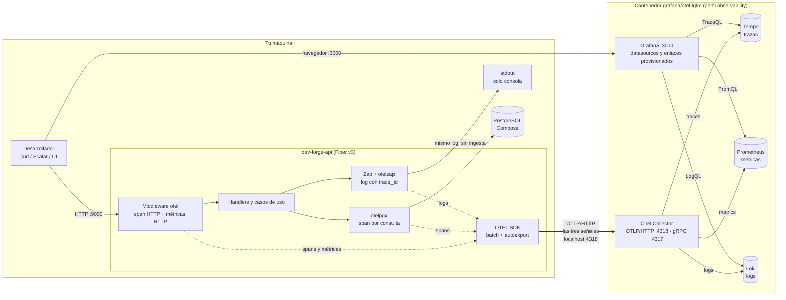
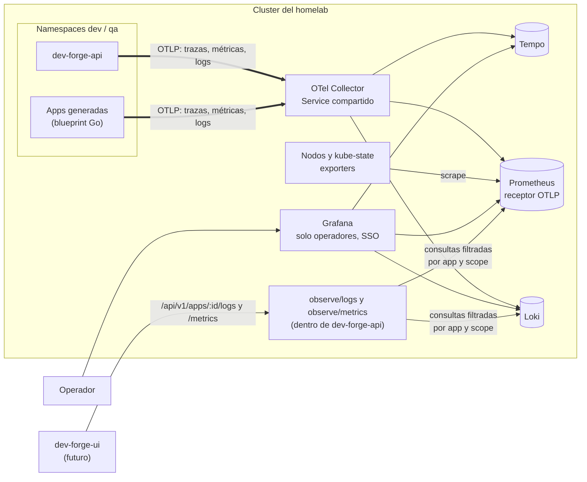
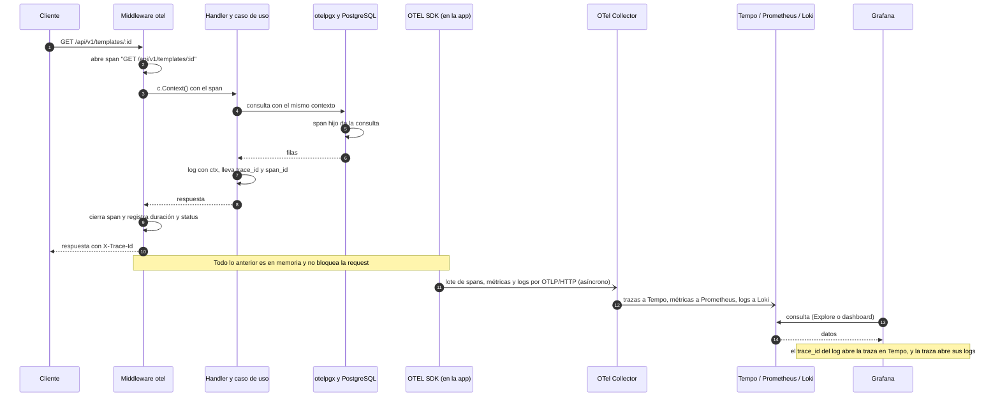

# Plan de implementación y pruebas del stack de observabilidad

**Fecha:** 2026-11-01  
**Base:** [OBSERVABILITY.md](OBSERVABILITY.md) (análisis y decisiones, en especial §7, §8, §12 y §13).  
**Relación con otros planes:** adelanta parte de la Fase 4 de [DEV-FORGE-PLAN.md](DEV-FORGE-PLAN.md) (4.2–4.6). Los cambios que este plan exige en ese archivo están en la [sección 8](#8-cambios-requeridos-en-dev-forge-planmd).

**Leyenda:** ⬜ pendiente · 🔵 en progreso · ✅ hecho y verificado · ⛔ bloqueado.

## 1. Objetivo y alcance

Instrumentar `dev-forge-api` con trazas, métricas y logs correlacionados vía OTLP, y poder **levantar y probar todo el stack en local** con un único comando. El mismo binario debe funcionar después en el homelab cambiando solo variables de entorno.

**Dentro del alcance:** paquete de telemetría, instrumentación HTTP/PostgreSQL/logs, laboratorio local, pruebas automatizadas, robustez, documentación y preparación para el blueprint y el homelab.

**Fuera del alcance** (viven en el plan de producto):
- Despliegue del stack en el homelab (4.1): aún no está operativo.
- Módulos `observe/logs` y `observe/metrics` (4.7–4.8).
- Alertas y backups (4.9).
- Extracción del blueprint a un repo propio (4.5; aquí solo se deja preparado).
- Cambio de proveedor de auth (tarea independiente, ver OBSERVABILITY.md §13 decisión 1).

### 1.1 Vista general del stack

#### Herramientas y responsabilidades

| Herramienta | Rol | Señal | Dónde corre (local) | Dónde corre (homelab, objetivo) |
|---|---|---|---|---|
| **dev-forge-api** (Fiber v3) | Genera la telemetría | Las tres | Host (`make run`) o contenedor | Pod |
| **OTEL SDK** + `autoexport` | Crea spans, métricas y logs; los agrupa y los exporta por OTLP/HTTP | Las tres | Dentro de la app | Dentro de la app |
| **Middleware `gofiber/contrib/v3/otel`** | Span de servidor y métricas HTTP por request | Trazas, métricas | Dentro de la app | Dentro de la app |
| **`otelpgx`** | Un span por consulta a PostgreSQL | Trazas | Dentro de la app | Dentro de la app |
| **`otelzap`** (bridge de Zap) | Convierte cada log en un registro OTLP con `trace_id`/`span_id` | Logs | Dentro de la app | Dentro de la app |
| **OTel Collector** | Recibe OTLP (`:4318`) y reparte cada señal a su backend | Las tres | Dentro de `otel-lgtm` | Servicio compartido del cluster |
| **Tempo** | Almacena y consulta trazas | Trazas | Dentro de `otel-lgtm` | Despliegue propio (Helm) |
| **Prometheus** | Almacena y consulta métricas (PromQL); acepta OTLP; en el cluster también scrapea nodos y kube-state | Métricas | Dentro de `otel-lgtm` | Despliegue propio (Helm) |
| **Loki** | Almacena y consulta logs (LogQL) | Logs | Dentro de `otel-lgtm` | Despliegue propio (Helm) |
| **Grafana** | Dashboards, Explore y enlaces log ↔ traza ↔ métrica (`:3000`) | Consulta | Dentro de `otel-lgtm` | Despliegue propio (Helm) |
| **`observe/logs`, `observe/metrics`** (futuro, 4.7–4.8) | API de producto que consulta Loki/Prometheus con autorización por app y scope | Consulta | — | Dentro de dev-forge-api |
| **stdout de Zap** | Solo consola y `kubectl logs`; **no se ingiere** | — | Terminal | Logs del pod |

`otel-lgtm` es una sola imagen que agrupa Collector, Tempo, Prometheus, Loki y Grafana para desarrollo y pruebas. En el homelab esos mismos componentes se instalan por separado; la app no nota la diferencia.

#### Flujo de las señales (local)

#### Flujo en el homelab (objetivo)

Solo cambia el destino de OTLP; la app es la misma.

Configuración que cambia entre local y homelab: `OTEL_EXPORTER_OTLP_ENDPOINT`, `OTEL_EXPORTER_OTLP_HEADERS` (si hay autenticación) y `OTEL_RESOURCE_ATTRIBUTES` (entorno). Nada más.

#### Viaje de una request

Si el Collector o un backend no responde, el SDK descarta con límites acotados y la request no se ve afectada; la telemetría puede perderse.

## 2. Decisiones congeladas

Origen: OBSERVABILITY.md §13 (2026-11-01).

| Tema | Decisión |
|---|---|
| Transporte | Las tres señales por OTLP/HTTP a un único endpoint. Sin `/metrics`, sin ServiceMonitor, sin agente de logs, sin socket de Docker. |
| Stack local | `grafana/otel-lgtm` con versión fijada (probada `0.39.0`), perfil `observability` de Compose. |
| Librerías | `gofiber/contrib/v3/otel` v1.3.2, SDK `otel` v1.47.0, `autoexport` v0.72.0, `otelzap` v0.21.0, `otelpgx` v0.13.0, `contrib/instrumentation/runtime` v0.72.0. Verificar de nuevo contra el proxy de Go al iniciar cada fase por si hay versiones nuevas. |
| Configuración | Variables estándar `OTEL_*` leídas por `autoexport`/SDK; solo se añade lo que OTEL no define (`OTEL_ENABLED`). |
| Fallos | Configuración inválida: error explícito al arrancar. Backend caído: operación normal con descarte acotado. Deshabilitado: no-op sin panic. |
| Sampling | `parentbased_always_on` (100 %) en dev/qa. |
| Logs | `zapcore.NewTee`: stdout (consola/JSON) + bridge `otelzap`. Solo la vía OTLP se ingiere en Loki. |

## 3. Hallazgos del código actual que condicionan el plan

Revisión estática del 2026-11-01.

| # | Hallazgo | Evidencia | Consecuencia |
|---|---|---|---|
| H1 | Los handlers y el middleware de auth usan `c.RequestCtx()` (el contexto de fasthttp). Ese contexto **no lleva el span**; el middleware OTEL lo publica en `c.Context()`. | [template_handler.go](internal/template/adapters/handler/template_handler.go), [auth.go](internal/shared/middleware/auth.go) | Sin cambiarlo, los spans de `otelpgx` no cuelgan del span HTTP aunque todo "compile y funcione". Tarea F3. |
| H2 | `zapLogger` lee `c.Response().StatusCode()` tras `c.Next()`; con error devuelto, el status aún no es el final. | [middleware.go](internal/shared/server/middleware.go) | Log, métricas y span pueden discrepar. El middleware OTEL ejecuta el error handler y devuelve `nil`: el logger debe ir **después** y no depender de `err`. |
| H3 | `otelpgx` solo se instala si `OTEL.Enabled` y toma el provider global, que hoy nadie configura. | [database.go](internal/shared/database/database.go) | El provider debe inicializarse antes de `database.New`. |
| H4 | `log.Fatal` en `main` omite los `defer` y no hay shutdown de telemetría. | [main.go](cmd/server/main.go) | Reestructurar el ciclo de vida (salida controlada, shutdown con timeout). |
| H5 | `OTEL_EXPORTER_OTLP_ENDPOINT=localhost:4317` (sin esquema, estilo gRPC). | [.env.example](.env.example), [config.go](internal/shared/config/config.go) | OTLP/HTTP exige URL con esquema (`http://localhost:4318`). `OTELConfig.OTLPEndpoint` pasa a ser redundante. |
| H6 | `/ready` responde un literal; `/health` también. | [health.go](internal/shared/server/health.go) | Readiness no comprueba la DB (OBSERVABILITY.md §8.5). Tarea F6. |
| H7 | El logger no recibe contexto; hay dos logs por error (`handler error` y `request error`). | [logger.go](internal/shared/logger/logger.go), [middleware.go](internal/shared/server/middleware.go) | Hay que pasar `ctx` para correlacionar y unificar el log de error. |
| H8 | DEV-FORGE-PLAN 4.2, 4.5 y 4.6 describen `/metrics` y recolección de stdout. | [DEV-FORGE-PLAN.md](DEV-FORGE-PLAN.md) | Contradicen la decisión vigente (sección 8). |

## 4. Contrato de configuración objetivo

| Variable | Valor local de ejemplo | Quién la define |
|---|---|---|
| `OTEL_ENABLED` | `true` con el perfil activo; `false` por defecto | Propia (interruptor global) |
| `OTEL_SERVICE_NAME` | `dev-forge` | Estándar |
| `OTEL_RESOURCE_ATTRIBUTES` | `service.version=0.1.0,deployment.environment.name=development` | Estándar (sustituye a `OTEL_SERVICE_VERSION`; se mantiene como fallback durante la migración) |
| `OTEL_EXPORTER_OTLP_ENDPOINT` | `http://localhost:4318` | Estándar |
| `OTEL_EXPORTER_OTLP_PROTOCOL` | `http/protobuf` | Estándar |
| `OTEL_EXPORTER_OTLP_HEADERS` | vacío (en homelab, si hay auth) | Estándar |
| `OTEL_TRACES_SAMPLER` / `_ARG` | `parentbased_always_on` | Estándar |
| `OTEL_{TRACES,METRICS,LOGS}_EXPORTER` | `otlp` (o `none` para apagar una señal) | Estándar |
| `OTEL_METRIC_EXPORT_INTERVAL` | `10000` local, `30000`–`60000` homelab | Estándar |

Al implementar hay que **confirmar con tests** qué valores inválidos devuelve `autoexport` como error (el protocolo desconocido sí) y cuáles el SDK degrada en silencio (p. ej. un sampler desconocido o un argumento mal formado). Estos últimos se validan explícitamente en `telemetry.Setup` para cumplir «error explícito al arrancar».

## 5. Fases

Orden de dependencias: F0 → F1 → F2 → F3 → F4 → F5 → F6 → F7. F1 puede hacerse en paralelo con F2.

### Fase 0 — Preparación y línea base 🔵

| ID | Tarea | Verificación |
|---|---|---|
| OP-0.1 | Actualizar dependencias OTEL existentes. `otelpgx` v0.13.0 y API/SDK v1.47.0 instalados; los módulos aún no utilizados (`autoexport`, `otelzap`, runtime y middleware Fiber) se incorporarán en F2–F4, cuando tengan imports, porque `go mod tidy` elimina dependencias sin uso. | Build y pruebas con selección equivalente a `make test` pasan; cobertura 76,7 % antes y después. ⬜ Pendiente incorporar los módulos futuros. |
| OP-0.2 | Confirmar memoria disponible para Docker Desktop. | ✅ Docker dispone de ~3,83 GiB; el laboratorio llegó a ~1,34 GiB durante las pruebas. No es una garantía de capacidad para otras cargas. |
| OP-0.3 | Actualizar `.env.example` al contrato de la sección 4 y eliminar el endpoint sin esquema (H5). | ✅ Ejemplo actualizado; las variables nuevas no están conectadas a exporters todavía. |
| OP-0.4 | Fijar convención de nombres: paquete `internal/shared/telemetry` (ya reservado en DEV-FORGE-PLAN). | ✅ Reservado; la implementación corresponde a F2. |

**Gate F0:** build y tests actuales sin regresiones tras el bump. Verificados para las dependencias ya usadas; el resto se instalará y verificará con su implementación. `go test` con cobertura sobre *todos* los paquetes falló por falta de la herramienta `covdata` en el toolchain local; la selección de paquetes con tests del Makefile sí pasó.

### Fase 1 — Laboratorio local ✅

| ID | Tarea | Verificación |
|---|---|---|
| OP-1.1 | Añadir `otel-lgtm` con perfil `observability`, puertos locales, healthcheck de Grafana y volumen opcional mediante overlay. | ✅ Arranque y healthcheck verificados; persistencia comprobada al recrear el contenedor. |
| OP-1.2 | Targets `obs-up`, `obs-down`, `obs-clean` y `obs-logs`. | ✅ Verificados con proyecto Compose aislado. `obs-clean` exige confirmación y elimina solo su volumen; se comprobó que el volumen de PostgreSQL permanece. |
| OP-1.3 | Script de humo con `telemetrygen` por OTLP/HTTP y consultas a los tres backends mediante Grafana. | ✅ `make obs-smoke-stack` encuentra las tres señales con un identificador nuevo; falla si Grafana no está disponible. |
| OP-1.4 | Documentar uso, puertos, credenciales, limpieza y límites. | ✅ [Guía del laboratorio](docs/observability-local.md). |

**Gate F1:** verificado en un clon local aislado con los archivos de esta implementación copiados al clon, sin `.env` ni credenciales del autor: `make obs-up` seguido de `make obs-smoke-stack` encontró las tres señales. El clon aún necesita esos cambios porque no están confirmados en Git.

### Fase 2 — Paquete `telemetry` ⬜

Ubicación: `internal/shared/telemetry/`.

| ID | Tarea | Verificación |
|---|---|---|
| OP-2.1 | `Setup(ctx, cfg) (shutdown func(context.Context) error, err error)`. Crea `Resource` (`resource.WithFromEnv`, nombre, versión, entorno), propagadores W3C TraceContext + Baggage, y registra TracerProvider, MeterProvider y LoggerProvider globales. | Test unitario con exporters en memoria |
| OP-2.2 | Exporters con `autoexport` (`NewSpanExporter`, `NewMetricReader`, `NewLogExporter`) para respetar `OTEL_*`. Batching con límites del SDK. | Tests con `OTEL_*_EXPORTER=none` y `otlp` |
| OP-2.3 | Validación estricta de configuración (sampler, protocolo, intervalo, endpoint) con errores claros que incluyan la variable ofensiva. | Tabla de casos inválidos → error; válidos → ok |
| OP-2.4 | Modo deshabilitado (`OTEL_ENABLED=false`): providers no-op, `shutdown` no-op, sin panic. No asumir que `OTEL_SDK_DISABLED` funciona sin probarlo. | Test |
| OP-2.5 | `otel.SetErrorHandler` que registre los fallos de exportación **una vez por intervalo**, sin inundar logs ni bloquear. | Test con exporter que falla |
| OP-2.6 | Métricas de runtime Go (`instrumentation/runtime`). Métricas del pool pgx solo si aportan valor verificado. | Aparecen en el backend (F5) |
| OP-2.7 | Reestructurar [main.go](cmd/server/main.go) (H4): `Setup` antes de `database.New`; salida controlada sin `log.Fatal` que omita defers; apagado ordenado: dejar de aceptar requests → esperar en curso → shutdown de telemetría con timeout → cerrar DB → sincronizar logger. Timeout ajustable al grace period de Kubernetes. | Test de shutdown dentro del plazo (también con Collector caído, en F6) |
| OP-2.8 | Retirar `OTELConfig.OTLPEndpoint` y dejar en `config` solo lo propio (`Enabled`). | `config_test.go` actualizado |

**Gate F2:** con `OTEL_ENABLED=true` y el stack arriba, la app arranca y exporta; con configuración inválida falla al arrancar; deshabilitada, no hay panic.

### Fase 3 — Instrumentación HTTP, contexto y PostgreSQL ⬜

| ID | Tarea | Verificación |
|---|---|---|
| OP-3.1 | Registrar `fiberotel.New(...)` en [server.go](internal/shared/server/server.go) con este orden: `requestid` → `recover` → **otel** → `cors` → logger de acceso. `WithNext` excluye `/health` y `/ready`. | Test: probes sin spans ni métricas |
| OP-3.2 | Decidir y fijar `WithPublicEndpoint` (la API recibe tráfico de clientes no controlados: iniciar traza nueva enlazada es lo prudente) y `WithTraceResponseHeader("X-Trace-Id")`. Dejar `WithClientIP` según revisión de privacidad. | Tests de propagación entrante |
| OP-3.3 | Sustituir `c.RequestCtx()` por `c.Context()` en handlers y en el middleware de auth (H1). | Test: span de repositorio es hijo del span HTTP |
| OP-3.4 | Instalar `otelpgx` siempre que la telemetría esté habilitada, tras `Setup` (H3). Sin `db.statement` con valores. | Spans pgx con parentesco correcto |
| OP-3.5 | Corregir el logger de acceso (H2): leer el status final tras el middleware OTEL, no basarse en `err`, y no registrar dos veces el mismo error (H7). | Tests 2xx/4xx/5xx/panic |
| OP-3.6 | Spans de negocio solo donde ayuden (por ejemplo `template.Create`); no uno por función. | Revisión |
| OP-3.7 | Tests HTTP con `app.Test` y exporters en memoria (`tracetest`, `ManualReader`): nombre `GET /api/...:id`, `http.route` con plantilla, 404 sin `http.route`, 4xx sin status de error en el span, 5xx con error, panic recuperado, `traceparent` entrante. | `make test` |

**Gate F3:** una request HTTP→caso de uso→DB comparte `trace_id` y la jerarquía correcta en tests; las métricas HTTP tienen solo labels de baja cardinalidad.

### Fase 4 — Logs y correlación ⬜

| ID | Tarea | Verificación |
|---|---|---|
| OP-4.1 | En [logger.go](internal/shared/logger/logger.go): `zapcore.NewTee` con el core actual (stdout) y `otelzap.NewCore` con el `LoggerProvider` global. Stdout en JSON cuando `DEBUG=false`, consola en debug. | Test con `logtest`/exporter en memoria |
| OP-4.2 | Helper para loggear con contexto (`zap.Any("context", ctx)` es el campo que `otelzap` usa como contexto) y usarlo en handlers, middleware y errores. **Cierra el pendiente «confirmar que otelzap propaga el contexto del span»** para logs de handlers; los logs de dependencias sin contexto se documentan como sin correlación. | Log con `trace_id`/`span_id` válidos; log sin span no los lleva |
| OP-4.3 | Añadir `trace_id`/`span_id` al stdout para que la consola también se pueda correlacionar. | Test sobre salida JSON |
| OP-4.4 | Revisar qué se loggea: sin `Authorization`, cookies, bodies, tokens ni PII; revisar `ip` y `path` (los paths con IDs son campos, no labels). Redacción en el Collector solo como defensa adicional. | Test con request que lleva un token en el path o query: no aparece |
| OP-4.5 | Comprobar en Loki cómo llegan `trace_id`/`span_id` (metadato estructurado, no label indexada) y que la regla derivada del datasource de `otel-lgtm` (`matcherType: label`, regex `trace_id`) abre la traza. Si no encaja, ajustar el provisioning propio. | Verificación manual en Grafana + F5 |
| OP-4.6 | Comprobar que cada log llega **una sola vez** a Loki (stdout no se ingiere). | Consulta por `trace_id`: 1 resultado |

**Gate F4:** desde un log en Grafana se abre su traza, y viceversa.

### Fase 5 — Verificación integrada con la app real ⬜

Cierra el pendiente «verificar el stack local con la app real» y los criterios 1–6 y 9 de OBSERVABILITY.md §12.

| ID | Tarea | Verificación |
|---|---|---|
| OP-5.1 | Test de integración etiquetado (`//go:build obsintegration`) que levanta la app en proceso con telemetría real hacia `localhost:4318`, ejecuta requests (2xx, 4xx, 5xx, panic, un flujo con DB, muchas rutas 404 y muchos IDs) y consulta Tempo, Loki y Prometheus por el proxy de Grafana con reintentos y timeout. Target `make obs-smoke`. | Todas las aserciones pasan |
| OP-5.2 | Aserciones: métricas `http_server_request_duration_seconds_*` con `http_route` y status esperados; traza HTTP + span pgx; log encontrado una vez con su `trace_id`; **sin series nuevas** por ID o 404 distinto. | Test |
| OP-5.3 | Registrar los **nombres reales** tras la traducción OTEL → Prometheus y las labels promovidas desde atributos de recurso (`service_name`, `deployment_environment_name`) en Loki y Prometheus. | Documento con la tabla |
| OP-5.4 | Dashboard mínimo RED (tasa, errores, latencia p50/p95/p99 por ruta) provisionado por archivo, más la ruta de montaje en `otel-lgtm` (ver su sección «Customize backend configuration»). | Se carga sin pasos manuales |
| OP-5.5 | Medir volumen: series activas, bytes de logs y trazas por request y por hora con tráfico de ejemplo; extrapolar a dev+qa del homelab. Sirve para **validar o corregir el dimensionado inicial** (§13 decisión 5). | Tabla de mediciones |
| OP-5.6 | Caso de traza no muestreada: con `OTEL_TRACES_SAMPLER=parentbased_traceidratio` y ratio 0 → el log lleva IDs inválidos o ausentes y no rompe nada. | Test |

**Gate F5:** `make obs-up && make obs-smoke` pasa desde un clon limpio; Grafana abre con datasources y dashboard provisionados.

### Fase 6 — Robustez, privacidad y readiness ⬜

Criterios 7–9 de OBSERVABILITY.md §12.

| ID | Tarea | Verificación |
|---|---|---|
| OP-6.1 | Con el contenedor detenido o pausado (`docker pause`), una operación de negocio y `/ready` siguen respondiendo dentro de un timeout; los errores de exportación se registran con límite. | Test de integración |
| OP-6.2 | Memoria acotada bajo carga con el backend caído (colas del SDK limitadas) y sin goroutines que se acumulen. | Prueba de carga corta + `runtime` metrics |
| OP-6.3 | Shutdown dentro del plazo con Collector caído y con telemetría deshabilitada. | Test |
| OP-6.4 | `/ready` comprueba la DB con timeout y **no** depende de observabilidad (H6). `/health` sigue sin dependencias. | Test con DB caída |
| OP-6.5 | Pruebas de cardinalidad y de secretos: un generador de requests con miles de IDs y paths no crea miles de series ni labels con datos de entrada; búsqueda automática de patrones sensibles en las señales de prueba. | Test |
| OP-6.6 | Pruebas de configuración inválida: cada caso de la tabla de OP-2.3 hace fallar el arranque con mensaje claro. | Test |
| OP-6.7 | Añadir los tests unitarios al `make test`/`test-check` existente; los de integración quedan en un target aparte (necesitan Docker). Evaluar un job opcional de CI. | CI/Make |

**Gate F6:** todos los criterios de la sección 6 marcados como cubiertos por pruebas.

### Fase 7 — Documentación y preparación para blueprint y homelab ⬜

| ID | Tarea | Verificación |
|---|---|---|
| OP-7.1 | Runbook `docs/observability.md`: cómo levantar, variables, cómo ver una request en Grafana, cómo limpiar, problemas conocidos. | Una persona ajena lo sigue sin ayuda |
| OP-7.2 | Documentar el contrato de configuración para el homelab: solo `OTEL_EXPORTER_OTLP_ENDPOINT`, cabeceras si hay auth y atributos de recurso. Anotar el requisito de OTLP en Prometheus (`--web.enable-otlp-receiver` o remote-write desde el Collector). | Revisión |
| OP-7.3 | **Pendiente: inventario del homelab** (Prometheus/Operator, Grafana, Loki, Tempo, agentes). Se ejecuta cuando el homelab esté operativo; queda ⛔ hasta entonces. | Inventario escrito |
| OP-7.4 | **Pendiente: decidir despliegue del stack** en el homelab: Helm de los componentes frente al manifiesto de `otel-lgtm` como solución provisional (el upstream lo declara solo para dev/demo/test). Depende de OP-7.3 y de OP-5.5. | Decisión registrada |
| OP-7.5 | Inventario de lo parametrizable para el blueprint (`service.name`, nombre de módulo, dashboard, datos del primer proyecto) y de lo que no debe copiarse. Alimenta DEV-FORGE-PLAN 4.5. | Lista revisada |
| OP-7.6 | Actualizar OBSERVABILITY.md (§3 estado real, §13 pendientes) y DEV-FORGE-PLAN.md con lo realmente comprobado. | Diff revisado |

**Gate F7:** documentación suficiente para repetir el laboratorio y para que el homelab solo requiera variables de entorno; pendientes de homelab registrados.

## 6. Matriz de pruebas

Cobertura de los criterios de aceptación de OBSERVABILITY.md §12 en este plan.

| Criterio §12 | Cómo se verifica | Fase |
|---|---|---|
| 1. Generar/clonar, compilar, tests y arrancar | `make test`, `make run` | F0, F3 |
| 2. Perfil local con provisioning sin pasos ocultos | `make obs-up`, dashboard provisionado | F1, F5 |
| 3. Métricas con labels esperadas, sin series por ID/404 | OP-5.2, OP-6.5 | F5, F6 |
| 4. Traza con span HTTP y pgx relacionados | OP-3.3, OP-3.7, OP-5.2 | F3, F5 |
| 5. Log una vez, `trace_id` y salto log → traza; caso no muestreado | OP-4.5, OP-4.6, OP-5.6 | F4, F5 |
| 6. 2xx, 4xx, 5xx, errores y panic coherentes | OP-3.5, OP-3.7 | F3 |
| 7. Collector o backend caído | OP-6.1, OP-6.2 | F6 |
| 8. Sin telemetría o deshabilitada; shutdown en plazo | OP-2.4, OP-6.3 | F2, F6 |
| 9. Sin secretos ni PII; `trace_id` no es label indexada | OP-4.4, OP-4.5, OP-6.5 | F4, F6 |
| 10. Dos apps en Kubernetes sin duplicados | Requiere cluster | Fuera de este plan (homelab) |
| 11. Segundo proyecto con otro nombre | Requiere blueprint | Fuera de este plan (4.5) |

Capas de prueba:
- **Unitarias:** configuración, validación, no-op, mapeo de errores y logger, con exporters en memoria. Sin Docker.
- **HTTP en proceso:** `app.Test` con `tracetest` y `ManualReader`. Sin Docker.
- **Integración local** (`obsintegration`): app real contra `otel-lgtm`; consultas por el proxy de Grafana.
- **Caos básico:** pausar el contenedor, detener la DB.
- **No cubierto aquí:** HA, retención de producción, autorización multiusuario y descubrimiento en Kubernetes.

## 7. Pendientes de OBSERVABILITY.md §13 y su ubicación

| Pendiente | Fase / tarea | Estado |
|---|---|---|
| Verificar el stack local con la app real | F5 (OP-5.1 a OP-5.4) | ⬜ |
| Confirmar que `otelzap` propaga el contexto del span a los logs | F4 (OP-4.2) | ⬜ |
| Inventariar el homelab | F7 (OP-7.3) | ⛔ homelab no operativo |
| Decidir Helm o `otel-lgtm` provisional en el homelab | F7 (OP-7.4) | ⛔ depende de OP-7.3 |
| Validar el dimensionado inicial (retención, PVC, series) | F5 (OP-5.5), F7 (OP-7.4) | ⬜ |
| Tarea aparte: desacoplar auth de Zitadel | Fuera de este plan | ⬜ |

## 8. Cambios requeridos en DEV-FORGE-PLAN.md

Aplicados en DEV-FORGE-PLAN.md el 2026-11-01 (tareas 4.1, 4.2, 4.3, 4.4, 4.5 y 4.6, criterio de verificación de logs y enlace a este plan). Esta tabla se conserva como registro de lo que cambió.

| Tarea | Texto actual | Cambio propuesto |
|---|---|---|
| 4.2 | «métricas OTEL expuestas en `/metrics` para scrape directo» | Métricas por OTLP al Collector; configuración por variables `OTEL_*` |
| 4.5 | «`/metrics`, logs JSON a stdout» | Contrato del blueprint: trazas, métricas y logs por OTLP; stdout solo para consola |
| 4.6 | «Collector Contrib recoge stdout/stderr» | Logs por OTLP con `otelzap`; recolección de stdout solo como adición futura para workloads sin OTLP |
| 4.1 | Despliegue de backends | Añadir el requisito de OTLP en Prometheus y la opción provisional `otel-lgtm` |

## 9. Riesgos

| Riesgo | Mitigación |
|---|---|
| La señal de logs de OTEL Go está en *release candidate* y `otelzap` (v0.21) y `otlploghttp` (v0.23) son 0.x. | Versiones fijadas; test de contrato en F4; plan B: stdout + Alloy. |
| Los spans no cuelgan del span HTTP por usar `c.RequestCtx()` (H1). | OP-3.3 y su test de parentesco. |
| Errores de configuración que el SDK degrada en silencio. | OP-2.3 y OP-6.6. |
| Los nombres de métricas y labels cambian por la traducción OTEL → Prometheus. | OP-5.3; los dashboards se prueban contra el backend real. |
| `otel-lgtm` no es el stack del homelab. | F7 lo separa explícitamente; el contrato de la app es independiente del backend. |
| Docker Desktop con poca memoria. | OP-0.2. |
| Nuevas versiones durante la implementación. | Revalidar versiones al iniciar cada fase. |

## 10. Definición de «terminado» de este plan

1. `make obs-up && make obs-smoke` pasa desde un clon limpio, sin credenciales del autor.
2. Tests unitarios y HTTP verdes en `make test`.
3. Los criterios 1–9 de la matriz están cubiertos por pruebas, no por inspección manual.
4. OBSERVABILITY.md y DEV-FORGE-PLAN.md reflejan **solo** lo comprobado.
5. Los pendientes de homelab quedan registrados con su dependencia.

## Log de cambios

| Fecha | Cambio |
|---|---|
| 2026-11-01 | Creación del plan a partir de OBSERVABILITY.md y de la revisión del código. |
